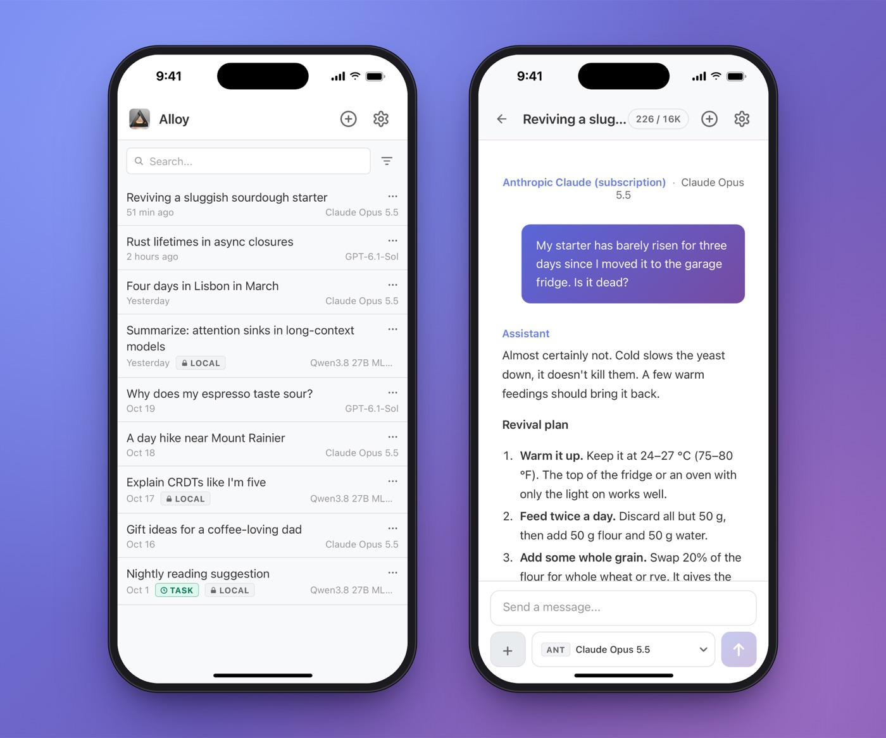

Ten months of Alloy: local where it counts
===
posted: Oct 21, 2026

I started [Alloy](/alloy-local-first-ai-workbench/) almost a year ago as a model-agnostic AI chat app, so that my conversations would live in plaintext files I control. It has since become my AI chat app of choice. I use it daily on my laptop and on my phone as a PWA. Local means private, and that matters a lot; I fully trust my own machine in a way I can't trust a cloud, even one that claims to run in a trusted execution environment. When Alloy started, local models weren't good enough to do much, but now they are quite good, if still slow.

<!--more-->

# How I use Alloy

This chart is just a sliver of how I actually use AI. Alloy is an AI chat app, not an agent harness, so I continue to rely on Pi, Codex, or Claude Code for coding and deeper project work.

## Interfacing with cloud models

I started out with a direct API integration for each provider (Anthropic, OpenAI, Gemini, Grok), but keeping up with each one's quirks was a pain, so in May I replaced them all with OpenRouter's single API. Most of my chats go through OpenAI and Anthropic subscriptions via the `codex` and `claude` command line tools. Local models run through [oMLX](https://github.com/jundot/omlx).

The mix has shifted a lot. In the spring, nearly everything went through direct APIs, mostly Gemini Flash because of price. But whether direct or via OpenRouter, pay-per-token usage adds up, and since I'm already paying for subscriptions to the frontier labs, I've embraced their clouds at no extra cost.

## Enabling local and remote access

The same Alloy runs on both of my Macs. The only difference is that the Mac mini's copy is reachable from outside my home network through an authenticated [Cloudflare Tunnel](https://developers.cloudflare.com/cloudflare-one/connections/connect-networks/). My local model, Qwen 3.8 27B, runs on the MacBook Pro, which has 128 GB of unified memory.

## It works on my phone!

Alloy is a PWA which lives on my phone's home screen and behaves like an app. It's served by the always-on Mac mini, which is reachable from anywhere through the tunnel and can relay to the MacBook Pro if it's home, enabling private conversations to work on the go. Since I started tracking this in early October, about a quarter of my messages have come from my phone.

# Local where it counts

Local models are still slow. On private data, a typical local reply takes about two minutes, and one in ten takes over 15 minutes. This is a very long time compared to under half a minute for Codex or Claude. Even so, there are two places where local is now my default: processing private data at night, and starting private chats locally before switching to the cloud.

## Slowly processing at night

Two recurring tasks run on the local model overnight, reading private data and taking their sweet time:

1. **Reading suggestion**: the local model reads my most recent notes, infers what I'm into lately, and suggests one paper or article to read. If it can't find a good match, it stays quiet. It remembers what it suggested on previous runs, so it doesn't repeat itself. Over the last 40 nights, it made 16 suggestions and stayed quiet on the rest, which is by design: I'd rather get nothing than filler. The best one so far was Elinor Ostrom's *Governing the Commons*. I'd been sketching a shared "family commons" for a side project, and it pointed me to Ostrom's principles for how communities govern shared resources. It got there from my project notes alone, but Ostrom was already on my to-read list, which felt like a good sign. I haven't read it yet. Its main weakness is that when my notes are about a book, it sometimes recommends that same book back to me.

2. **Spending audit**: every week, the local model audits transactions, comparing totals and categorical breakdowns against the previous weeks, tracking new merchants, and big or duplicate charges.

The transactions come from [SimpleFIN](https://www.simplefin.org/), a cheap, read-only bridge to my bank and card accounts. A small script on the Mac mini pulls each week's transactions down as CSVs, and the Alloy task just reads those files. Honestly, an agent that owned the whole pipeline, SimpleFIN included, would be less fiddly. But my transactions map to locations, times, and spending habits, so keeping them private is worth the friction (see [[Tyranny of convenience rests on felt benefits and abstract costs]]).

Not everything financial is private, though. A weekly stock dip alert runs on Codex, because I don't mind a cloud model knowing which stocks I follow.

## Start local, switch to cloud

One of Alloy's strengths is that it lets me switch model providers in the middle of a conversation, which enables a pattern that's useful for privacy.

For anything personal, I start local and switch to the cloud only when I need to. The local model has full read access to my Obsidian vault, which is about as personal as my data gets. If what it finds isn't itself sensitive, I switch to a cloud model on the second turn for higher intelligence and faster responses.

When I switch models from local to cloud, Alloy warns me that the cloud model will see my messages and the local model's replies, but not the files it reads or its reasoning.

---

If you'd like to try Alloy, you can [download it for macOS](https://github.com/borismus/alloy/releases). The [source is on GitHub](https://github.com/borismus/alloy). If you try it, or you're experimenting with local models yourself, drop me a [line](mailto:boris@smus.com).
